# jsb-plus

『점프 투 스프링부트』를 AI 코딩 에이전트와 함께 구현하고, 장희성 강사의 14163·14168 수업 내용을 적용하여 개선하는 프로젝트입니다.

## 개발 환경
- Java 25
- Spring Boot 4.1.2
- Gradle 9.8.2 (Kotlin DSL, `build.gradle.kts`)

## 참고 자료
- [점프 투 스프링부트 교재](https://wikidocs.net/book/7601)
- [14163 — 점프 투 스프링부트 개선](https://www.slog.gg/p/14163/raw)
- [14168 — JPA, 타임리프 개선](https://www.slog.gg/p/14168/raw)

## 작업내역

### 001-01 프로젝트 세팅, 스프링 이니셜라이저로 프로젝트 생성
- [링크](https://github.com/zoek1211/jsb-plus/releases/tag/001-01)
- 작업: Spring Initializr로 프로젝트 생성(Web, Lombok, DevTools), foojay 플러그인 추가, README 작성
- 이유: 강사 실습 환경(Spring Boot 4.1.2, Java 25, Gradle Kotlin DSL)과 동일하게 시작하기 위함
- 결과: `./gradlew test` 통과, 애플리케이션 8080 포트 정상 실행 확인

### 000-01 AI 에이전트 스킬 설정, 이슈 트래커·라벨·도메인 문서 구성
- [링크](https://github.com/zoek1211/jsb-plus/releases/tag/000-01)
- 작업: `AGENTS.md`에 과제 절대 규칙·커밋 규칙 정리, `docs/agents/`에 이슈 트래커·트리아지 라벨·도메인 문서 설정 추가, GitHub 라벨 생성
- 이유: AI 에이전트가 과제 규칙(작은 작업, 승인 후 진행, 커밋·README 형식)을 매번 자동으로 따르도록 하기 위함
- 결과: GitHub에 트리아지 라벨 5개 확인, 애플리케이션 코드 변경 없음

### 000-02 AI 에이전트 스킬 설정, CLAUDE.md에서 AGENTS.md 불러오기
- [링크](https://github.com/zoek1211/jsb-plus/releases/tag/000-02)
- 작업: `@AGENTS.md` 한 줄짜리 `CLAUDE.md` 추가
- 이유: Claude Code는 `CLAUDE.md`만 자동으로 읽으므로, 과제 규칙(`AGENTS.md`)이 매 세션 자동 적용되도록 하기 위함
- 결과: 규칙은 `AGENTS.md` 한 곳에서만 관리, 애플리케이션 코드 변경 없음

### 002-01 메인 컨트롤러, 액션 메서드 2개 추가
- [링크](https://github.com/zoek1211/jsb-plus/releases/tag/002-01)
- 작업: `MainController`에 `/`, `/hello` 를 처리하는 `void` 액션 메서드 추가 (콘솔 출력만)
- 이유: 14163 3강 방식대로 `@ResponseBody` 없이 먼저 실행해 보고, 메서드 호출과 응답 생성이 별개라는 것을 확인하기 위함
- 결과: 콘솔에 `index() 메서드 호출됨!`, `hello() 메서드 호출됨!` 출력 확인, 브라우저는 500 에러(Circular view path) 응답

### 000-03 AI 에이전트 스킬 설정, 학습용 주석 규칙 추가
- [링크](https://github.com/zoek1211/jsb-plus/releases/tag/000-03)
- 작업: `AGENTS.md`에 학습용 주석 규칙(한국어+영어) 추가, 기존 코드 파일 5개에 주석 작성
- 이유: 코드를 읽으면서 각 줄이 무엇을, 왜 하는지 바로 이해하기 위함
- 결과: `./gradlew test` 통과, 동작 변경 없음 (주석만 추가)

### 002-02 메인 컨트롤러, @ResponseBody로 응답 본문 반환
- [링크](https://github.com/zoek1211/jsb-plus/releases/tag/002-02)
- 작업: 액션 메서드에 `@ResponseBody` 추가, `String` 반환 (`/` → `SBB`, `/hello` → `안녕하세요 ^ ^`), `MainControllerTest`(MockMvc) 추가
- 이유: 14163 4강 — 반환값이 템플릿 이름이 아니라 응답 본문이 되도록 하여 002-01의 500 에러 해결
- 결과: 테스트 3개 통과, 브라우저에서 `SBB`, `안녕하세요 ^ ^` 표시 확인

### 003-01 데이터베이스 설정, H2 추가 및 dev·test 프로필 분리
- [링크](https://github.com/zoek1211/jsb-plus/releases/tag/003-01)
- 작업: H2·H2 콘솔 의존성 추가, `application.properties` → `application.yaml` 전환, `application-dev.yaml`(파일 DB)·`application-test.yaml`(메모리 DB) 추가, 테스트에 `@ActiveProfiles("test")`, DB 파일 `.gitignore` 처리
- 이유: 14163 5강 — 교재처럼 DB 파일을 직접 만들지 않고, 개발 데이터와 테스트 데이터를 분리하기 위함
- 결과: 테스트 3개 통과(`test` 프로필), 앱은 `dev` 프로필로 실행, `/h2-console` 접속 확인. DB 파일은 아직 없음 (DB에 연결하는 코드가 없기 때문, 003-02 JPA 추가 후 생성)

### 000-04 AI 에이전트 스킬 설정, 범위 조정 및 교재 비교 문서 추가
- [링크](https://github.com/zoek1211/jsb-plus/releases/tag/000-04)
- 작업: `docs/book-vs-ours.md`(교재 vs 우리 비교표) 추가, `AGENTS.md`에 범위(1~3장)·영상 목표·비교표 갱신 규칙 추가
- 이유: 도전과제를 빼고 3장까지 구현한 뒤 영상을 만들기로 함. 교재와 달라진 점을 작업하면서 모아 두기 위함
- 결과: 지금까지의 차이 6가지 정리, 애플리케이션 코드 변경 없음

### 003-02 데이터베이스 설정, JPA 추가 및 SQL 로그 출력
- [링크](https://github.com/zoek1211/jsb-plus/releases/tag/003-02)
- 작업: `spring-boot-starter-data-jpa`(+ 테스트용) 의존성 추가, `ddl-auto: update`, SQL 출력(`show-sql`, `format_sql`, `highlight_sql`, `use_sql_comments`), 바인딩 값·트랜잭션 TRACE 로그 설정
- 이유: 14163 6강 — 자바 객체로 DB를 다루기 위한 준비, 실행되는 SQL과 실제 값까지 눈으로 확인하기 위함
- 결과: 테스트 3개 통과(메모리 DB `db_test` 연결 확인), 앱 실행 시 `db_dev.mv.db` 생성, H2 콘솔로 `jdbc:h2:./db_dev` 접속 성공 (테이블은 아직 없음)

### 004-01 엔티티, Question 엔티티 추가
- [링크](https://github.com/zoek1211/jsb-plus/releases/tag/004-01)
- 작업: `Question` 엔티티 추가 (`id`, `createDate`, `subject`(200자), `content`(TEXT))
- 이유: 14163 7강 — 질문 데이터를 저장할 테이블을 자바 클래스로 정의. 교재와 달리 답변 목록(`@OneToMany`)·getter/setter는 아직 넣지 않고 하나씩 추가
- 결과: 테스트 3개 통과, 로그에서 `create table question` 확인, H2 콘솔에서 `QUESTION` 테이블(ID, CONTENT, CREATE_DATE, SUBJECT) 확인

### 004-02 엔티티, Answer 엔티티 추가 (@ManyToOne)
- [링크](https://github.com/zoek1211/jsb-plus/releases/tag/004-02)
- 작업: `Answer` 엔티티 추가 (`id`, `createDate`, `content`(TEXT), `@ManyToOne Question question`)
- 이유: 14163 7강 — 답변이 어느 질문에 속하는지 저장. 먼저 `@ManyToOne` 단방향만 만들고 `@OneToMany`는 이후 강의에서 비교하며 추가
- 결과: 테스트 3개 통과, 로그에서 `question_id` 컬럼과 외래 키 제약조건 확인, H2 콘솔에서 `ANSWER` 테이블(ID, CONTENT, CREATE_DATE, QUESTION_ID) 확인

### 005-01 엔티티 관계, @OneToMany 추가 (mappedBy 없이 실험)
- [링크](https://github.com/zoek1211/jsb-plus/releases/tag/005-01)
- 작업: `Question`에 `@OneToMany(cascade = REMOVE) List<Answer> answers` 추가 — 일부러 `mappedBy` 생략
- 이유: 14163 11강 — `mappedBy`가 없으면 어떤 일이 생기는지 직접 확인
- 결과: 테스트 3개 통과, 로그에서 `create table question_answers (question_id, answers_id)` 확인, H2 콘솔에 불필요한 `QUESTION_ANSWERS` 중간 테이블 생성 확인 (005-02에서 수정)

### 005-02 엔티티 관계, @OneToMany에 mappedBy 추가
- [링크](https://github.com/zoek1211/jsb-plus/releases/tag/005-02)
- 작업: `@OneToMany(mappedBy = "question", cascade = REMOVE)` 로 수정, 개발 DB에 남은 `QUESTION_ANSWERS` 테이블을 H2 콘솔에서 직접 `DROP TABLE`
- 이유: 14163 12강 — 답변 목록이 `answer.question_id` 를 재사용하도록 하여 중간 테이블 제거. `ddl-auto: update` 는 테이블을 지우지 않으므로 직접 정리
- 결과: 테스트 3개 통과, 테스트 로그에는 `answer`, `question` 테이블만 생성, 개발 DB에도 `ANSWER`, `QUESTION` 만 남음 확인

### 006-01 리포지터리, QuestionRepository 추가
- [링크](https://github.com/zoek1211/jsb-plus/releases/tag/006-01)
- 작업: `QuestionRepository extends JpaRepository<Question, Integer>` 추가, `Question`에 롬복 `@Getter @Setter` 추가
- 이유: 14163 14강 — SQL 없이 질문을 저장·조회하기 위한 준비, private 필드를 다른 클래스에서 읽고 쓰기 위함
- 결과: 테스트 3개 통과, 로그에서 `Found 1 JPA repository interface` 확인, 컴파일된 클래스에서 getter/setter 10개 생성 확인

### 006-02 리포지터리, 테스트용 샘플 데이터(TestInitData) 추가
- [링크](https://github.com/zoek1211/jsb-plus/releases/tag/006-02)
- 작업: `@Profile("test")` 설정 클래스 `TestInitData` 추가, `ApplicationRunner`로 앱 시작 직후 샘플 질문 2개 저장 (`self` 프록시 + `@Lazy` + `@Transactional`)
- 이유: 14163 14강 — 테스트마다 데이터를 만들지 않고, 항상 같은 샘플 데이터에서 테스트를 시작하기 위함. 개발 DB에는 넣지 않음
- 결과: 테스트 3개 통과, 로그에서 `TestInitData$$SpringCGLIB$$0.work1` 트랜잭션·`insert` 2건·바인딩 값 확인, 개발 DB `QUESTION` 행 수 0 확인

### 006-03 리포지터리, QuestionRepositoryTest 추가 (findAll)
- [링크](https://github.com/zoek1211/jsb-plus/releases/tag/006-03)
- 작업: `QuestionRepositoryTest` 추가, `findAll()` 결과가 2개이고 첫 질문 제목이 `sbb가 무엇인가요?` 인지 검사
- 이유: 14163 14~15강 — 리포지터리 동작을 자동 테스트로 확인. 교재처럼 `SbbApplicationTests`에 몰아넣지 않고 검사 대상별 테스트 클래스로 분리
- 결과: 테스트 4개 통과, 로그에서 `select ... from question` 확인. 기대값을 3으로 바꾸면 `expected: <3> but was: <2>` 로 실패하는 것도 확인 후 원복

### 007-01 리포지터리, findById 테스트 추가
- [링크](https://github.com/zoek1211/jsb-plus/releases/tag/007-01)
- 작업: `QuestionRepositoryTest.t2` 추가 — `findById(1).orElseThrow()` 로 조회 후 제목 검사
- 이유: 14163 15강 — id로 질문 하나 조회. 교재·강사의 `if (oq.isPresent())` 방식은 값이 없을 때 검사를 건너뛰어 테스트가 통과해 버리므로 `orElseThrow()` 로 개선
- 결과: 테스트 5개 통과. `findById(99)` 로 바꿔 보니 교재 방식은 통과(가짜 초록불), 우리 방식은 `NoSuchElementException: No value present` 로 실패 확인 후 원복

### 007-02 리포지터리, 테스트 검사 방식을 AssertJ로 변경
- [링크](https://github.com/zoek1211/jsb-plus/releases/tag/007-02)
- 작업: `QuestionRepositoryTest` 의 JUnit `assertEquals` → AssertJ `assertThat(...).hasSize(...)`, `isEqualTo(...)` 로 변경
- 이유: 14163 16강 — 문장처럼 읽히고, 기대값·실제값 순서를 헷갈릴 일이 없으며, 실패 메시지에 목록 내용까지 나옴
- 결과: 테스트 5개 통과. `hasSize(3)` 으로 바꿔 보니 `Expected size: 3 but was: 2 in: [...]` 로 실패하는 것 확인 후 원복

### 007-03 리포지터리, findBySubject·findBySubjectAndContent 쿼리 메서드 추가
- [링크](https://github.com/zoek1211/jsb-plus/releases/tag/007-03)
- 작업: `QuestionRepository`에 `Optional<Question> findBySubject`, `findBySubjectAndContent` 추가, 테스트 t3·t4 추가
- 이유: 14163 16강 — 메서드 이름만으로 SQL을 만드는 쿼리 메서드 학습. 교재와 달리 결과 없음을 `null` 이 아닌 `Optional` 로 표현
- 결과: 테스트 7개 통과, 로그에서 `where q1_0.subject=?`, `where q1_0.subject=? and q1_0.content=?` 와 바인딩 값 순서 확인

### 007-04 리포지터리, findBySubjectLike 쿼리 메서드 추가
- [링크](https://github.com/zoek1211/jsb-plus/releases/tag/007-04)
- 작업: `List<Question> findBySubjectLike(String subjectLike)` 추가, 테스트 t5 추가 (`"sbb%"` 로 조회 → 1개, 제목 확인)
- 이유: 14163 17강 — 패턴 검색(`LIKE`, `%`) 학습. 여러 개가 나올 수 있어 `List` 반환. 교재와 달리 결과 개수까지 검사해 다른 질문이 걸러졌는지 확인
- 결과: 테스트 8개 통과, 로그에서 `where q1_0.subject like ? escape '\'` 와 바인딩 값 `sbb%` 확인

### 008-01 리포지터리, 데이터 수정 테스트 추가 (@Transactional 롤백)
- [링크](https://github.com/zoek1211/jsb-plus/releases/tag/008-01)
- 작업: `QuestionRepositoryTest.t6` 추가 — 질문 1번 제목을 "수정된 제목"으로 바꿔 `save`, 바뀐 제목으로 다시 찾아 id 1 확인. 테스트 메서드에 `@Transactional`
- 이유: 14163 18강 — 데이터를 바꾸는 테스트가 다른 테스트에 영향을 주지 않도록, 테스트가 끝나면 롤백
- 결과: 테스트 9개 통과, 로그에서 `update question set ... where id=?` 확인. `@Transactional` 없이 수정 테스트를 먼저 실행하면 나머지 5개가 모두 실패, 붙이면 먼저 실행해도 모두 통과하는 것 확인 (시연 코드는 원복)

### 008-02 리포지터리, 데이터 삭제 테스트 추가
- [링크](https://github.com/zoek1211/jsb-plus/releases/tag/008-02)
- 작업: `QuestionRepositoryTest.t7` 추가 — `count()` 2 확인 → 질문 1번 `delete` → `count()` 1 확인, `@Transactional` 로 롤백
- 이유: 14163 19강 — 리포지터리로 데이터를 삭제하는 방법 학습, 수정 테스트와 같은 이유로 롤백해 다른 테스트에 영향 없음
- 결과: 테스트 10개 통과, 로그에서 `delete from question where id=?` 확인

### 000-05 AI 에이전트 스킬 설정, README에 핵심 변경·실행화면 추가 규칙
- [링크](https://github.com/zoek1211/jsb-plus/releases/tag/000-05)
- 작업: `AGENTS.md` 의 README 작업내역 형식에 `핵심 변경`(코드 몇 줄)과 `실행화면`(캡처 이미지) 항목 추가
- 이유: 각 커밋에서 무엇이 바뀌었고 실제로 어떻게 동작했는지 README만 보고 알 수 있도록 하기 위함 (영상 제작 자료)
- 결과: 문서만 변경, 애플리케이션 코드 변경 없음
- 핵심 변경:
  ```markdown
  - 핵심 변경: (코드 블록)
  - 실행화면: 
  ```
- 실행화면: 해당 없음 (문서 변경)

### 009-01 답변, AnswerRepository 추가 및 답변 저장 테스트
- [링크](https://github.com/zoek1211/jsb-plus/releases/tag/009-01)
- 작업: `Answer`에 `@Getter @Setter`, `AnswerRepository` 추가, 2번 질문에 답변을 저장하는 테스트 t8 추가
- 이유: 14163 20강 — 답변도 리포지터리로 저장. `setQuestion()` 으로 어떤 질문의 답변인지 연결
- 결과: 테스트 11개 통과, 로그에서 `insert into answer (content, create_date, question_id, id)` 확인
- 핵심 변경:
  ```java
  public interface AnswerRepository extends JpaRepository<Answer, Integer> { }

  Answer answer = new Answer();
  answer.setQuestion(question);   // question_id = 2
  answerRepository.save(answer);  // INSERT INTO answer ...
  ```
- 실행화면:

  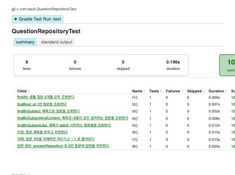

### 009-02 답변, question.addAnswer 로 답변 추가 (cascade PERSIST)
- [링크](https://github.com/zoek1211/jsb-plus/releases/tag/009-02)
- 작업: `Question.answers` 를 `new ArrayList<>()` 로 초기화, `cascade = {PERSIST, REMOVE}`, `addAnswer(content)` 편의 메서드 추가, 샘플 데이터에 2번 질문 답변 1개, 테스트 t9
- 이유: 14163 21·23강 — 질문 객체만으로 답변을 추가·저장. 목록을 초기화하지 않으면 새 질문에서 `NullPointerException`
- 결과: 테스트 12개 통과. `addAnswer` 직후 id 0, `flush()` 후 id 생성 확인. 앱 시작 로그에 샘플 답변 INSERT 확인
- 핵심 변경:
  ```java
  @OneToMany(mappedBy = "question", cascade = {CascadeType.PERSIST, CascadeType.REMOVE})
  private List<Answer> answers = new ArrayList<>();

  public Answer addAnswer(String content) {
      Answer answer = new Answer();
      answer.setContent(content);
      answer.setQuestion(this);   // 외래 키(주인 쪽)
      answers.add(answer);        // 자바 목록
      return answer;
  }
  ```
- 실행화면:

  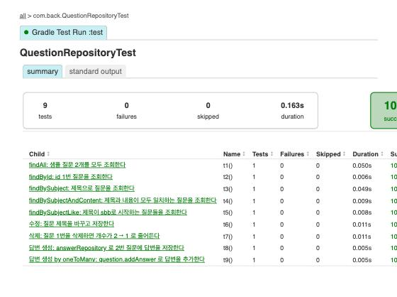

### 009-03 답변, LAZY 로딩과 테스트 클래스 @Transactional
- [링크](https://github.com/zoek1211/jsb-plus/releases/tag/009-03)
- 작업: 답변 조회 테스트 t10·t11 추가, `Answer.question` 을 `@ManyToOne(fetch = LAZY)` 로 변경, 테스트 클래스 전체에 `@Transactional` (메서드별 `@Transactional` 제거)
- 이유: 14163 22~25강 — `@OneToMany` 는 기본 LAZY 라서 트랜잭션 밖에서 `question.getAnswers()` 를 쓰면 `LazyInitializationException`. EAGER 대신 LAZY + 트랜잭션으로 해결
- 결과: 수정 전 t11 실패 (`Cannot lazily initialize collection ... (no session)`), 수정 후 테스트 14개 통과
- 핵심 변경:
  ```java
  @SpringBootTest
  @Transactional              // 모든 테스트: 세션 유지(LAZY 동작) + 끝나면 롤백
  class QuestionRepositoryTest { ... }

  @ManyToOne(fetch = LAZY)    // Answer.question: 필요할 때만 질문 조회
  private Question question;
  ```
- 실행화면 (수정 전 → 수정 후):

  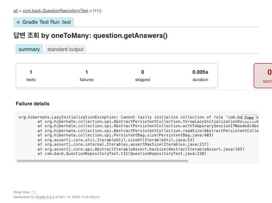

  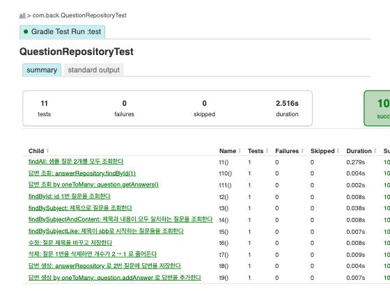

### 010-01 패키지 구조, 도메인별 패키지로 분류
- [링크](https://github.com/zoek1211/jsb-plus/releases/tag/010-01)
- 작업: `Question`·`QuestionRepository` → `com.back.question`, `Answer`·`AnswerRepository` → `com.back.answer`, 테스트 → `com.back.question`, 필요한 import 추가
- 이유: 교재 2-06 / 14163 26강 — 기능(도메인)별로 파일을 모아 찾기 쉽게 함
- 결과: 테스트 14개 통과, 테스트 리포트에 `com.back.question.QuestionRepositoryTest` 로 표시
- 핵심 변경:
  ```text
  com.back
  ├── BackApplication, MainController, TestInitData
  ├── question/  Question, QuestionRepository
  └── answer/    Answer, AnswerRepository
  ```
- 실행화면:

  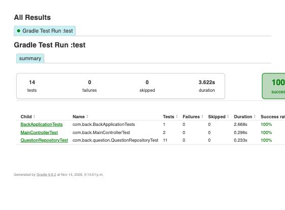

### 010-02 공통 엔티티, BaseEntity 와 JPA Auditing
- [링크](https://github.com/zoek1211/jsb-plus/releases/tag/010-02)
- 작업: `com.back.global.jpa.entity.BaseEntity` (id, createDate, modifyDate) 추가, `Question`·`Answer` 가 상속, `@EnableJpaAuditing`, 직접 부르던 `setCreateDate(LocalDateTime.now())` 제거, 테스트 t12
- 이유: 14168 5~6강 — 모든 엔티티의 공통 필드를 한 곳에서 관리하고 날짜는 자동으로 채움. 교재는 엔티티마다 id·날짜를 반복하고 수정일은 3-09에서야 추가
- 결과: 테스트 15개 통과, `create table question (id ..., create_date, modify_date, content, subject ...)` 확인
- 핵심 변경:
  ```java
  @MappedSuperclass
  @EntityListeners(AuditingEntityListener.class)
  @Getter
  public abstract class BaseEntity {
      @Id @GeneratedValue(strategy = IDENTITY) private int id;
      @CreatedDate private LocalDateTime createDate;
      @LastModifiedDate private LocalDateTime modifyDate;
  }

  public class Question extends BaseEntity { ... }
  ```
- 실행화면:

  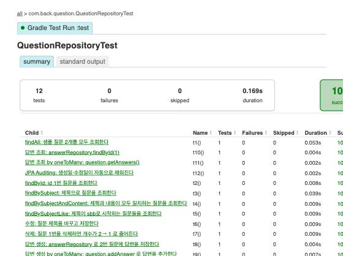

### 011-01 질문 목록, 자바 문자열로 HTML 응답
- [링크](https://github.com/zoek1211/jsb-plus/releases/tag/011-01)
- 작업: `QuestionController` 의 `GET /question/list` 가 질문 목록 HTML 을 자바 텍스트 블록으로 만들어 반환, 샘플 데이터를 dev 프로필에서도 생성 (`@Profile({"dev", "test"})`), `QuestionControllerTest` 추가
- 이유: 14163 27강 — 템플릿 없이 HTML 을 만들어 보며 타임리프가 필요한 이유를 확인. 브라우저로 볼 데이터가 필요해 dev 에도 샘플 데이터
- 결과: 테스트 16개 통과, 브라우저에서 질문 2개 목록 표시
- 핵심 변경:
  ```java
  @GetMapping("/question/list")
  @ResponseBody
  public String list() {
      String questionLiHtml = questionRepository.findAll().stream()
              .map(q -> "<li>%d / %s</li>".formatted(q.getId(), q.getSubject()))
              .collect(Collectors.joining("\n"));
      return """ <html> ... <ul>%s</ul> ... </html> """.formatted(questionLiHtml);
  }
  ```
- 실행화면:

  

### 011-02 질문 목록, 타임리프 템플릿으로 변경
- [링크](https://github.com/zoek1211/jsb-plus/releases/tag/011-02)
- 작업: `spring-boot-starter-thymeleaf` 추가, `templates/question_list.html` (표: 번호·제목·작성일시) 작성, 컨트롤러는 `Model` 에 `questionList` 를 담고 템플릿 이름 반환
- 이유: 교재 2-07 / 14163 28~32강 — HTML 은 템플릿 파일로, 자바는 데이터만 담당하도록 분리
- 결과: 테스트 16개 통과, 브라우저에서 질문 목록 표 확인
- 핵심 변경:
  ```java
  public String list(Model model) {
      model.addAttribute("questionList", questionRepository.findAll());
      return "question_list";   // templates/question_list.html
  }
  ```
  ```html
  <tr th:each="question : ${questionList}">
      <td th:text="${question.id}"></td>
      <td th:text="${question.subject}"></td>
      <td th:text="${question.createDate}"></td>
  </tr>
  ```
- 실행화면:

  

### 011-03 루트 URL, / 접속 시 질문 목록으로 리다이렉트
- [링크](https://github.com/zoek1211/jsb-plus/releases/tag/011-03)
- 작업: `MainController` 의 `GET /` 가 `redirect:/question/list` 반환, 연습용 `/hello` 와 "SBB" 응답 제거, `MainControllerTest` 를 리다이렉트 검사로 변경
- 이유: 교재 2-08 / 14163 33강 — 사이트 첫 화면을 질문 목록으로
- 결과: 테스트 15개 통과 (`is3xxRedirection`, `redirectedUrl("/question/list")`), 브라우저에서 `/` 접속 시 질문 목록 화면 표시
- 핵심 변경:
  ```java
  @GetMapping("/")
  public String index() {
      return "redirect:/question/list";   // HTTP 302 → 브라우저가 다시 요청
  }
  ```
- 실행화면 (`http://localhost:8080/` 접속 결과):

  

### 012-01 서비스, QuestionService 추가
- [링크](https://github.com/zoek1211/jsb-plus/releases/tag/012-01)
- 작업: `QuestionService.getList()` 추가, `QuestionController` 가 리포지터리 대신 서비스를 사용
- 이유: 교재 2-09 / 14163 34강 — 컨트롤러(웹) · 서비스(처리 규칙) · 리포지터리(DB) 역할 분리
- 결과: 테스트 15개 통과, 화면 동작은 그대로 (리팩터링)
- 핵심 변경:
  ```java
  @Service
  @RequiredArgsConstructor
  public class QuestionService {
      private final QuestionRepository questionRepository;
      public List<Question> getList() { return questionRepository.findAll(); }
  }
  // QuestionController: questionRepository.findAll() → questionService.getList()
  ```
- 실행화면 (테스트 리포트):

  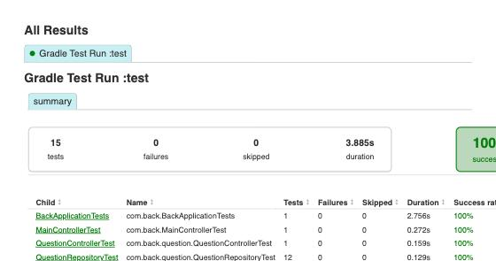

### 013-01 질문 상세, 상세 화면과 목록 링크
- [링크](https://github.com/zoek1211/jsb-plus/releases/tag/013-01)
- 작업: `GET /question/detail/{id}` (`@PathVariable`), `QuestionService.getQuestion(id)`, `question_detail.html`, 목록 제목을 상세 링크로 (`th:href`), 컨트롤러 테스트 t2
- 이유: 교재 2-10 / 14163 35강 — 목록에서 질문을 클릭해 내용을 보는 기능
- 결과: 테스트 16개 통과, 목록에서 제목 클릭 → `/question/detail/1` 상세 화면 확인
- 핵심 변경:
  ```java
  @GetMapping("/question/detail/{id}")
  public String detail(Model model, @PathVariable int id) {
      model.addAttribute("question", questionService.getQuestion(id));
      return "question_detail";
  }
  ```
  ```html
  <a th:href="@{|/question/detail/${question.id}|}" th:text="${question.subject}"></a>
  ```
- 실행화면 (목록에서 제목 클릭 후):

  

### 013-02 질문 상세, 없는 질문은 404 (DataNotFoundException)
- [링크](https://github.com/zoek1211/jsb-plus/releases/tag/013-02)
- 작업: `com.back.global.exception.DataNotFoundException` (`@ResponseStatus(NOT_FOUND)`) 추가, `getQuestion` 이 없으면 이 예외를 던짐, 컨트롤러 테스트 t3
- 이유: 교재 2-10 / 14163 35강 — 없는 주소를 500(서버 오류)이 아닌 404(없음)로 정확히 응답
- 결과: 테스트 17개 통과. `/question/detail/999` 가 수정 전 500 → 수정 후 404
- 핵심 변경:
  ```java
  @ResponseStatus(value = HttpStatus.NOT_FOUND, reason = "entity not found")
  public class DataNotFoundException extends RuntimeException { ... }

  return questionRepository.findById(id)
          .orElseThrow(() -> new DataNotFoundException("question not found"));
  ```
- 실행화면 (수정 전 500 → 수정 후 404):

  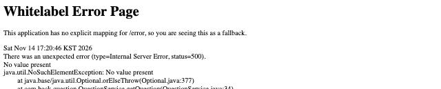

  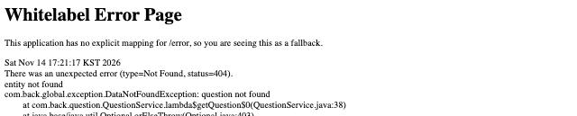

### 014-01 URL 프리픽스, @RequestMapping("/question")
- [링크](https://github.com/zoek1211/jsb-plus/releases/tag/014-01)
- 작업: `QuestionController` 클래스에 `@RequestMapping("/question")`, 메서드는 `/list`, `/detail/{id}` 로 줄임
- 이유: 교재 2-11 / 14163 36강 — 공통 URL 접두어를 한 곳에서 관리
- 결과: 테스트 17개 통과 (URL 은 그대로 `/question/list`, `/question/detail/{id}`)
- 핵심 변경:
  ```java
  @RequestMapping("/question")
  public class QuestionController {
      @GetMapping("/list") ...          // → /question/list
      @GetMapping("/detail/{id}") ...   // → /question/detail/{id}
  }
  ```
- 실행화면 (컨트롤러 테스트 리포트):

  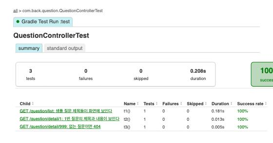

### 015-01 답변 등록, AnswerService·AnswerController 와 답변 폼
- [링크](https://github.com/zoek1211/jsb-plus/releases/tag/015-01)
- 작업: `AnswerService.create` (`@Transactional`, `question.addAnswer` + `save`), `AnswerController` 의 `POST /answer/create/{id}`, 상세 화면에 답변 개수·목록·등록 폼, `AnswerControllerTest`
- 이유: 교재 2-12 / 14163 37강 — 질문에 답변을 다는 기능. 생성 요청은 POST, 처리 후 redirect (새로고침 중복 등록 방지)
- 결과: 테스트 18개 통과, 브라우저에서 답변 등록 → 상세 화면으로 돌아와 답변 목록에 표시 (같은 답변 2개는 시연 중 두 번 제출한 것)
- 핵심 변경:
  ```java
  @PostMapping("/create/{id}")
  public String createAnswer(@PathVariable int id, @RequestParam("content") String content) {
      answerService.create(questionService.getQuestion(id), content);
      return "redirect:/question/detail/%d".formatted(id);
  }
  ```
  ```html
  <h5 th:text="|${#lists.size(question.answers)}개의 답변이 있습니다.|"></h5>
  <form th:action="@{|/answer/create/${question.id}|}" method="post"> ... </form>
  ```
- 실행화면:

  

### 016-01 화면 꾸미기, 스타일시트(style.css) 적용
- [링크](https://github.com/zoek1211/jsb-plus/releases/tag/016-01)
- 작업: `static/style.css` (textarea 너비 100%, 버튼 위 여백) 추가, 상세 화면에서 `<link th:href="@{/style.css}">` 로 불러옴
- 이유: 교재 2-13 / 14163 38강 — `static` 폴더의 정적 파일을 화면에서 사용하는 방법
- 결과: 테스트 18개 통과, 답변 입력칸이 화면 너비로 늘어남
- 핵심 변경:
  ```css
  textarea { width: 100%; }
  input[type=submit] { margin-top: 10px; }
  ```
  ```html
  <link rel="stylesheet" type="text/css" th:href="@{/style.css}">
  ```
- 실행화면:

  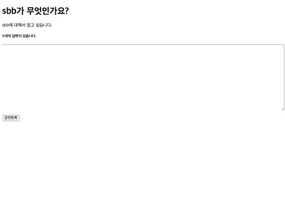

### 016-02 화면 꾸미기, 부트스트랩 적용
- [링크](https://github.com/zoek1211/jsb-plus/releases/tag/016-02)
- 작업: 목록·상세 템플릿에 부트스트랩 5.3.3 (CDN) 적용 — 표(`table`, `table-dark`), 카드(`card`), 버튼(`btn btn-primary`), 날짜 형식 `#temporals.format(..., 'yyyy-MM-dd HH:mm')`, 번호는 `loop.count`
- 이유: 교재 2-14 — 클래스 이름만으로 보기 좋은 화면 만들기
- 결과: 테스트 18개 통과, 목록은 어두운 머리글 표, 상세는 질문·답변 카드와 파란 등록 버튼
- 핵심 변경:
  ```html
  <link rel="stylesheet" href="https://cdn.jsdelivr.net/npm/bootstrap@5.3.3/dist/css/bootstrap.min.css">
  <table class="table"><thead class="table-dark"> ...
  <td th:text="${#temporals.format(question.createDate, 'yyyy-MM-dd HH:mm')}"></td>
  ```
- 실행화면 (목록 / 상세):

  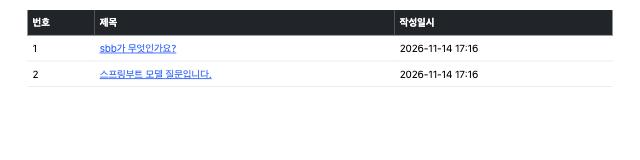

  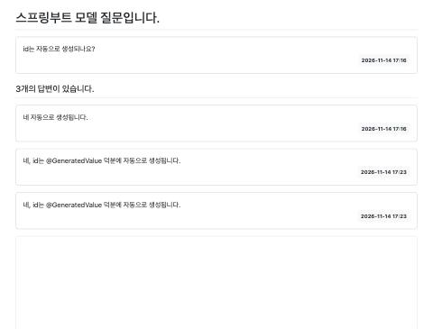

### 017-01 템플릿 상속, 레이아웃 방언(layout.html)
- [링크](https://github.com/zoek1211/jsb-plus/releases/tag/017-01)
- 작업: `thymeleaf-layout-dialect` 추가, 공통 틀 `templates/layout.html` (head·부트스트랩·style.css, `layout:title-pattern`), 목록·상세는 `layout:decorate="~{layout}"` + `layout:fragment="content"` 만 작성
- 이유: 교재 2-15 / 14168 44~45강 — 페이지마다 반복되던 `<head>` 를 한 곳으로. 교재의 `th:replace` 대신 레이아웃 방언으로 페이지가 틀을 "입는" 방식
- 결과: 테스트 18개 통과, 화면은 그대로, 브라우저 탭 제목이 `질문 목록 | SBB`
- 핵심 변경:
  ```html
  <!-- layout.html -->
  <title layout:title-pattern="$CONTENT_TITLE | $LAYOUT_TITLE">SBB</title>
  <th:block layout:fragment="content"></th:block>

  <!-- question_list.html -->
  <html layout:decorate="~{layout}">
  <div layout:fragment="content" class="container my-3"> ... </div>
  ```
- 실행화면 (탭 제목: 질문 목록 | SBB):

  

### 018-01 질문 등록, 등록 폼과 저장
- [링크](https://github.com/zoek1211/jsb-plus/releases/tag/018-01)
- 작업: `GET /question/create` (폼 화면 `question_form.html`), `POST /question/create` (저장 후 목록으로 redirect), `QuestionService.create`, 목록에 "질문 등록하기" 버튼, 컨트롤러 테스트 t4·t5
- 이유: 교재 2-16 — 질문 등록 기능. 14168 26강처럼 GET/POST 를 같은 URL 로 (교재처럼 별도 이름 불필요)
- 결과: 테스트 20개 통과, 브라우저에서 제목·내용 입력 → 저장 → 목록 3번에 새 질문
- 핵심 변경:
  ```java
  @GetMapping("/create")
  public String showCreate() { return "question_form"; }

  @PostMapping("/create")
  public String create(@RequestParam("subject") String subject, @RequestParam("content") String content) {
      questionService.create(subject, content);
      return "redirect:/question/list";
  }
  ```
- 실행화면 (입력 → 저장 후 목록):

  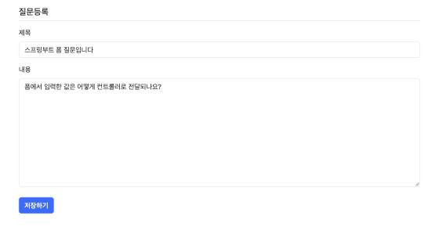

  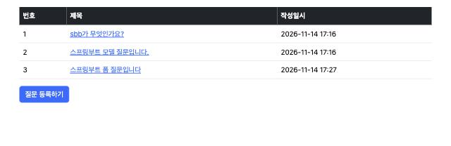

### 018-02 질문 등록, 입력값 검증 (record 폼 + @Valid + BindingResult)
- [링크](https://github.com/zoek1211/jsb-plus/releases/tag/018-02)
- 작업: `spring-boot-starter-validation` 추가, `QuestionForm` record (`@NotBlank`, `@Size(max=200)`), `@ModelAttribute("form") @Valid QuestionForm form, BindingResult bindingResult`, 오류 시 폼 다시 표시, 템플릿 `th:object`·`th:field`·`#fields.allErrors()`, 테스트 t6
- 이유: 교재 2-16 / 14168 9~23·40강 — 잘못된 값은 저장하지 않고, 입력했던 값과 오류 메시지를 함께 보여줌
- 결과: 테스트 21개 통과. 제목 없이 저장하면 "제목은 필수항목입니다." 와 함께 입력한 내용이 남은 폼이 다시 표시
- 핵심 변경:
  ```java
  public record QuestionForm(
          @NotBlank(message = "제목은 필수항목입니다.") @Size(max = 200) String subject,
          @NotBlank(message = "내용은 필수항목입니다.") String content) { }

  @PostMapping("/create")
  public String create(@ModelAttribute("form") @Valid QuestionForm form, BindingResult bindingResult) {
      if (bindingResult.hasErrors()) return "question_form";
      questionService.create(form.subject(), form.content());
      return "redirect:/question/list";
  }
  ```
  ```html
  <form th:object="${form}" ...>
    <div th:if="${#fields.hasAnyErrors()}"> <div th:each="err : ${#fields.allErrors()}" th:text="${err}"></div> </div>
    <input type="text" th:field="*{subject}">
  ```
- 실행화면 (제목 없이 저장):

  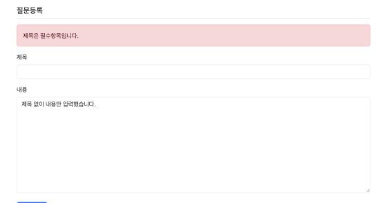

### 019-01 공통 템플릿, 폼 오류 조각(form_errors.html)과 답변 검증
- [링크](https://github.com/zoek1211/jsb-plus/releases/tag/019-01)
- 작업: `templates/form_errors.html` (`th:fragment="formErrorsFragment"`), 질문 폼과 답변 폼이 `th:replace` 로 사용, `AnswerForm` record (`@NotBlank`), `AnswerController` 에 `@Valid` + `BindingResult`, 상세 화면 답변 폼 `th:object="${answerForm}"`, 테스트 t2
- 이유: 교재 2-17 / 14168 25강 — 반복되는 오류 표시 HTML 을 한 곳에서 관리, 빈 답변 저장 방지
- 결과: 테스트 22개 통과, 빈 답변 등록 시 "내용은 필수항목입니다." 표시, 답변 0개 유지
- 핵심 변경:
  ```html
  <!-- form_errors.html -->
  <div th:fragment="formErrorsFragment" class="alert alert-danger" th:if="${#fields.hasAnyErrors()}">
      <div th:each="err : ${#fields.allErrors()}" th:text="${err}"></div>
  </div>
  <!-- 사용 -->
  <div th:replace="~{form_errors :: formErrorsFragment}"></div>
  ```
  ```java
  public String createAnswer(Model model, @PathVariable int id,
          @ModelAttribute("answerForm") @Valid AnswerForm answerForm, BindingResult bindingResult) {
      if (bindingResult.hasErrors()) { model.addAttribute("question", question); return "question_detail"; }
      ...
  ```
- 실행화면 (빈 답변 등록):

  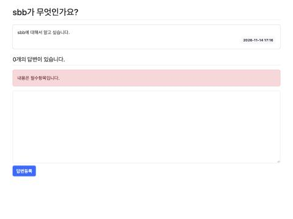

### 021-01 내비게이션 바, navbar 조각과 부트스트랩 JS
- [링크](https://github.com/zoek1211/jsb-plus/releases/tag/021-01)
- 작업: `templates/navbar.html` (`th:fragment="navbarFragment"`: SBB 로고 → `/`, 질문 목록 링크, 햄버거 버튼), `layout.html` 이 `th:replace` 로 포함, 부트스트랩 JS 번들 추가
- 이유: 교재 3-01 — 모든 화면 위쪽의 공통 메뉴. 좁은 화면에서는 햄버거 메뉴로 접힘 (JS 필요)
- 결과: 테스트 22개 통과, 모든 페이지에 내비게이션 바, 모바일 폭에서 햄버거 버튼으로 메뉴 펼침 확인
- 핵심 변경:
  ```html
  <!-- layout.html -->
  <nav th:replace="~{navbar :: navbarFragment}"></nav>
  <script src="https://cdn.jsdelivr.net/npm/bootstrap@5.3.3/dist/js/bootstrap.bundle.min.js"></script>
  ```
- 실행화면 (데스크톱 / 모바일 햄버거 메뉴):

  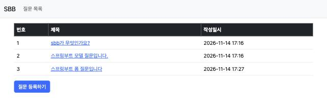

  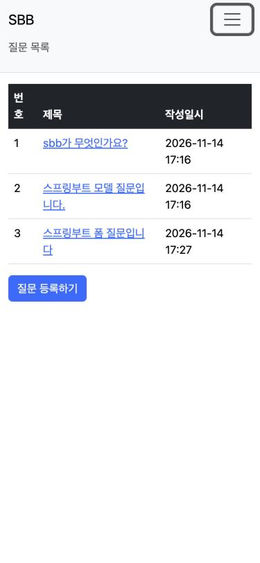

### 022-01 페이징, Page·PageRequest 와 페이지 이동 버튼
- [링크](https://github.com/zoek1211/jsb-plus/releases/tag/022-01)
- 작업: `QuestionService.getList(int page)` → `Page<Question>` (10개씩, id 내림차순), 컨트롤러 `@RequestParam(defaultValue = "0") int page`, 목록에 부트스트랩 페이지네이션 (현재 ±5, 이전·다음), dev 전용 `DevInitData` 로 질문 300개 생성 (`@Order`), `QuestionServiceTest`
- 이유: 교재 3-02 — 많은 글을 한 번에 보여주지 않고 페이지로 나눔
- 결과: 테스트 24개 통과, SQL `order by q1_0.id desc offset ? rows fetch first ? rows only`, 브라우저 `?page=7` 에서 8번 페이지 활성화
- 핵심 변경:
  ```java
  public Page<Question> getList(int page) {
      Pageable pageable = PageRequest.of(page, 10, Sort.by(Sort.Order.desc("id")));
      return questionRepository.findAll(pageable);
  }
  ```
  ```html
  <li th:each="page : ${#numbers.sequence(0, paging.totalPages - 1)}"
      th:if="${page >= paging.number - 5 and page <= paging.number + 5}"
      th:classappend="${page == paging.number} ? 'active'" class="page-item">
      <a th:text="${page + 1}" class="page-link" th:href="@{|?page=${page}|}"></a>
  </li>
  ```
- 실행화면 (`/question/list?page=7`):

  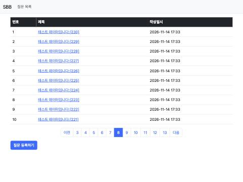

### 023-01 게시물 번호, 전체 개수부터 거꾸로 번호 매기기
- [링크](https://github.com/zoek1211/jsb-plus/releases/tag/023-01)
- 작업: 목록 번호를 `loop.count` 대신 `paging.totalElements - (paging.number * paging.size) - loop.index` 로, 컨트롤러 테스트 추가
- 이유: 교재 3-03 — 페이지마다 1~10 이 반복되지 않고, 전체에서의 순서가 이어지도록
- 결과: 테스트 25개 통과, 2페이지 번호 293~284 (전체 303개)
- 핵심 변경:
  ```html
  <td th:text="${paging.totalElements - (paging.number * paging.size) - loop.index}"></td>
  ```
- 실행화면 (`?page=1`, 즉 2페이지):

  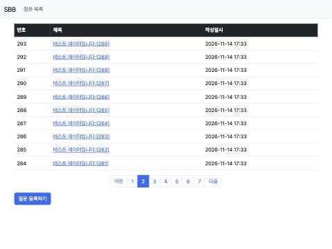

### 024-01 답변 개수 표시, 목록 제목 옆에 답변 수
- [링크](https://github.com/zoek1211/jsb-plus/releases/tag/024-01)
- 작업: 목록에서 답변이 1개 이상인 질문 제목 옆에 `#lists.size(question.answers)` 를 빨간 작은 글씨로, 컨트롤러 테스트 추가
- 이유: 교재 3-04 — 목록에서 바로 답변 여부 확인
- 결과: 테스트 26개 통과, 마지막 페이지의 2번 질문 옆에 답변 수 3 표시
- 핵심 변경:
  ```html
  <span class="text-danger small ms-2"
        th:if="${#lists.size(question.answers) > 0}"
        th:text="${#lists.size(question.answers)}"></span>
  ```
- 실행화면 (마지막 페이지):

  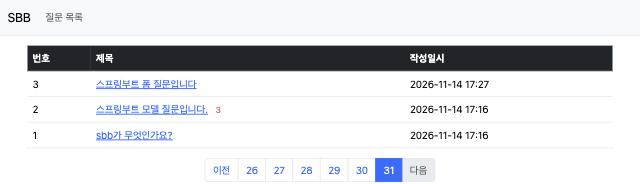

### 025-01 스프링 시큐리티, 도입과 기본 설정 (CSRF)
- [링크](https://github.com/zoek1211/jsb-plus/releases/tag/025-01)
- 작업: `spring-boot-starter-security`, `thymeleaf-extras-springsecurity6`, 테스트용 `spring-boot-starter-security-test` 추가, `com.back.global.security.SecurityConfig` (`SecurityFilterChain`: 모든 요청 허용, `/h2-console/**` 만 CSRF 예외, SAMEORIGIN frame 허용), POST 테스트에 `.with(csrf())`
- 이유: 교재 3-05 / 14168 46강 — 로그인·권한 기능 준비. CSRF 방어로 다른 사이트의 위조 POST 차단
- 결과: 시큐리티만 추가했을 때 POST 테스트 4개가 `403` 으로 실패 → `csrf()` 추가 후 테스트 26개 통과. 실제 폼에는 `th:action` 이 숨은 `_csrf` 토큰(96자)을 자동으로 넣어 등록 성공
- 핵심 변경:
  ```java
  @Bean
  public SecurityFilterChain filterChain(HttpSecurity http) throws Exception {
      http.authorizeHttpRequests(auth -> auth.requestMatchers("/**").permitAll())
          .csrf(csrf -> csrf.ignoringRequestMatchers("/h2-console/**"))
          .headers(h -> h.addHeaderWriter(new XFrameOptionsHeaderWriter(SAMEORIGIN)));
      return http.build();
  }
  // 테스트: mvc.perform(post("/question/create").with(csrf()) ...)
  ```
- 실행화면 (시큐리티 적용 후 폼으로 질문 등록 성공):

  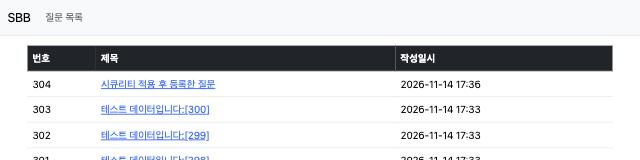

### 026-01 회원가입, SiteUser·UserService·회원가입 폼
- [링크](https://github.com/zoek1211/jsb-plus/releases/tag/026-01)
- 작업: `com.back.user` 패키지 — `SiteUser` (BaseEntity 상속, username·email `unique`), `UserRepository.findByUsername`, `UserService.create` (BCrypt 암호화), `UserCreateForm` record, `UserController` (`/user/signup` GET·POST: 검증 → 비밀번호 확인 `rejectValue` → 중복 `DataIntegrityViolationException` → `reject`), `PasswordEncoder` 빈, `signup_form.html`, 내비게이션 바 "회원가입", `UserControllerTest` 3개
- 이유: 교재 3-06 — 회원 기능의 시작. 비밀번호는 절대 원문으로 저장하지 않음
- 결과: 테스트 29개 통과. 비밀번호 확인 불일치 시 오류, 가입 후 DB에는 `$2a$10$...` 형식의 암호화된 비밀번호
- 핵심 변경:
  ```java
  @Bean
  public PasswordEncoder passwordEncoder() { return new BCryptPasswordEncoder(); }

  user.setPassword(passwordEncoder.encode(password));

  if (!form.password1().equals(form.password2())) {
      bindingResult.rejectValue("password2", "passwordInCorrect", "2개의 패스워드가 일치하지 않습니다.");
      return "signup_form";
  }
  try { userService.create(...); }
  catch (DataIntegrityViolationException e) { bindingResult.reject("signupFailed", "이미 등록된 사용자입니다."); ... }
  ```
- 실행화면 (비밀번호 불일치 / 가입 후 DB의 암호화된 비밀번호):

  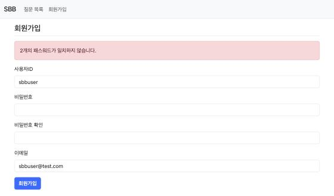

  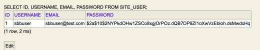
